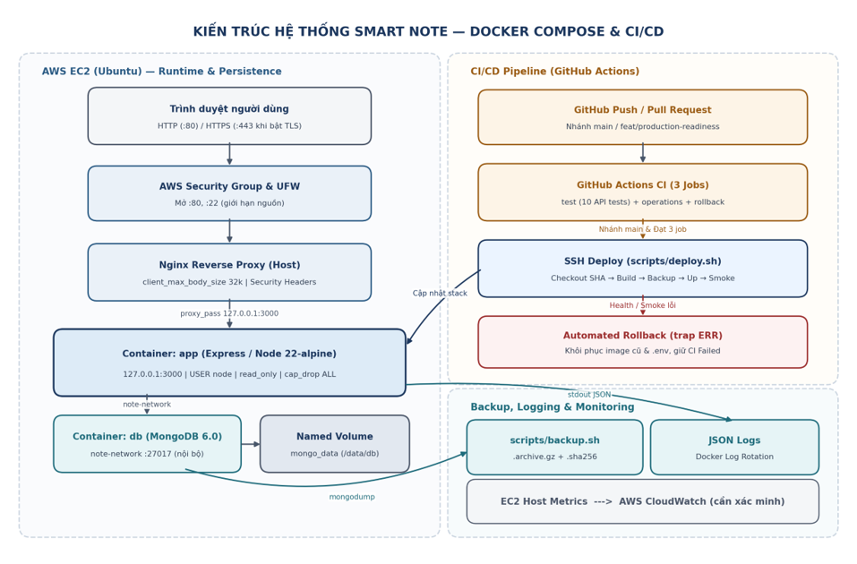
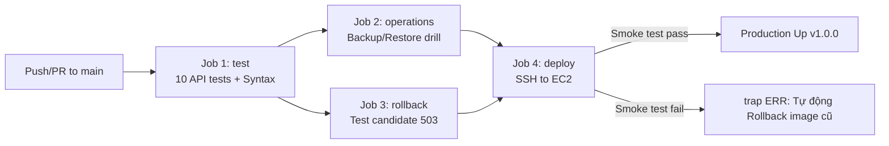

# Smart Note — Automated & Reliable Web Application Deployment

> **Đồ án Cuối kỳ Môn học DevOps (Học kỳ 2026)**  
> **Nhóm thực hiện:** Làng Xì Mi  
> **Repository:** [https://github.com/batoannguyen52-debug/devops-note-api](https://github.com/batoannguyen52-debug/devops-note-api)

---

## 👥 1. Thông tin Nhóm & Phân công Nhiệm vụ

| Thành viên | Vai trò phụ trách chính | Nhiệm vụ chi tiết trong đồ án |
|---|---|---|
| **Nguyễn Bá Toàn** | Hạ tầng Cloud & Mạng (Infrastructure & Security) | Thiết lập máy chủ AWS EC2 (Ubuntu 24.04), cấu hình tường lửa UFW & Security Group (cổng 22, 80, 443), cài đặt Nginx Reverse Proxy và tối ưu bảo mật host. |
| **Trần Tiến Minh** | Phát triển Backend & Kiểm thử (Backend & QA Automation) | Xây dựng API Express/Node.js, tách biệt endpoint `/live` và `/health` (MongoDB ping), viết bộ 10 bài kiểm thử tự động với Jest & Supertest, tối ưu Dockerfile multi-stage. |
| **Hồ Thăng Bảo Huy** | Quản trị Cơ sở dữ liệu & Tự động hóa CI/CD (DBA & DevOps) | Đóng gói MongoDB với Named Volume persistence, xây dựng pipeline GitHub Actions 4 jobs, kịch bản sao lưu `backup.sh` có mã băm SHA-256, `restore.sh` và cơ chế tự động Rollback. |

---

## 🏛️ 2. Kiến trúc Hệ thống Tổng thể (Tuần 4 - Final Production)

Hệ thống được thiết kế theo mô hình **Client – Reverse Proxy – Containerized App & Database** với quy trình tự động hóa khép kín:



### Các phân vùng cốt lõi:
1. **AWS EC2 (Ubuntu) — Runtime & Persistence:**
   * Tường lửa 2 lớp (**AWS Security Group & UFW**) bảo vệ hệ thống, chỉ mở công khai cổng `:80` (HTTP) và `:22` (SSH quản trị/deploy).
   * **Nginx Reverse Proxy** trên host giới hạn payload `client_max_body_size 32k`, gắn Security Headers và chuyển tiếp lưu lượng vào loopback `127.0.0.1:3000`.
   * **Container `note-api-app`:** Chạy user không đặc quyền `node`, hệ thống tệp chỉ đọc (`read_only: true`), loại bỏ Linux capabilities (`cap_drop: [ALL]`).
   * **Container `note-api-db`:** Nằm hoàn toàn trong mạng nội bộ `note-network` (không publish port ra ngoài), gắn kết với Named Volume `mongo_data` đảm bảo dữ liệu ghi chú tồn tại vĩnh viễn qua các lần cập nhật container.
2. **CI/CD Automation Pipeline (GitHub Actions):**
   * Tự động kích hoạt khi push code vào nhánh `main`.
   * Trải qua 3 jobs kiểm thử khắt khe: `test` (10 bài test API) → `operations` (diễn tập backup/restore và 3 sự cố trên container cô lập) → `rollback` (diễn tập hoàn nguyên khi gặp lỗi readiness).
   * Tự động SSH vào EC2 thực thi `scripts/deploy.sh`: Build-before-replace, backup dữ liệu trước khi nâng cấp, chờ readiness check và tự động rollback nếu smoke test thất bại.
3. **Backup, Logging & Monitoring:**
   * Script `scripts/backup.sh` tạo bản nén `.archive.gz` kèm file mã băm `.sha256` lưu ngoài thư mục source code.
   * Log ứng dụng xuất ra stdout chuẩn JSON, áp dụng Docker Log Rotation (`10MB x 3 file`) chống tràn đĩa.
   * Giám sát tài nguyên máy chủ EC2 thông qua AWS CloudWatch Alarm (ngưỡng CPU > 70%).

*Xem chi tiết phân tích kiến trúc tại: [docs/architecture/README.md](docs/architecture/README.md).*

---

## ⚡ 3. Hướng dẫn Khởi chạy Nhanh (Quick Start)

### Yêu cầu tiên quyết:
* Đã cài đặt **Docker Engine** và **Docker Compose v2** (khuyến nghị trên Linux/macOS hoặc WSL2 trên Windows).
* Đã cài đặt **Node.js >= 22.21.0** (nếu muốn chạy kiểm thử ở môi trường local).

### Các bước khởi chạy bằng Docker Compose:

```bash
# 1. Clone repository
git clone https://github.com/batoannguyen52-debug/devops-note-api.git
cd devops-note-api

# 2. Khởi tạo tệp biến môi trường
cp .env.example .env

# 3. Khởi chạy toàn bộ hệ thống (App + MongoDB)
docker compose up -d --build --wait

# 4. Kiểm tra sức khỏe hệ thống bằng smoke test
bash scripts/smoke-test.sh http://localhost:3000
```

Truy cập giao diện ứng dụng tại: `http://localhost:3000` (hoặc `http://<IP_SERVER>` nếu chạy qua Nginx trên port 80).

*Xem hướng dẫn thiết lập từ máy chủ Ubuntu sạch tại: [docs/deployment.md](docs/deployment.md).*

---

## 🧪 4. Kiểm thử Tự động (Automated Testing)

Dự án áp dụng bộ kiểm thử tích hợp API gồm **10 test cases** bao quát toàn bộ logic CRUD, xác thực dữ liệu đầu vào và phòng vệ lỗi:

```bash
# Cài đặt dependencies chuẩn xác theo lockfile
npm ci --ignore-scripts

# Chạy bộ test tự động với Jest & Supertest
npm test
```

### Danh mục 10 bài test API:
1. `GET /` — Phục vụ trang chủ HTML giao diện ghi chú thành công (200).
2. `GET /live` — Phản hồi liveness của tiến trình HTTP (200).
3. `GET /health` — Phản hồi readiness khi MongoDB sẵn sàng (200, status OK).
4. `GET /notes` — Lấy danh sách ghi chú thành công (200, mảng JSON).
5. `POST /notes` — Tạo ghi chú mới hợp lệ thành công (201).
6. `DELETE /notes/:id` — Xóa ghi chú thành công theo ID (200).
7. `DELETE /notes/invalid-id` — Xử lý lỗi khi ID sai định dạng ObjectId (400).
8. `POST /notes` (Validation) — Từ chối khi thiếu title hoặc content (400).
9. `POST /notes` (Security) — Lọc dữ liệu đầu vào, phòng chống HTML/XSS injection.
10. `GET /health` (Fault Injection) — Trả về 503 DEGRADED khi mất kết nối cơ sở dữ liệu.

---

## 🔄 5. Quy trình CI/CD & Cơ chế Tự động Rollback

Pipeline được định nghĩa tại file [.github/workflows/deploy.yml](.github/workflows/deploy.yml) gồm 4 jobs tuần tự:



* **Build-before-replace:** Image mới được build hoàn tất trước khi chạm vào container cũ, loại trừ rủi ro downtime do lỗi build.
* **Tự động sao lưu:** Script tự động kích hoạt `scripts/backup.sh` lưu lại trạng thái DB trước khi thay thế container.
* **Cơ chế Rollback tự động (`trap ERR`):** Nếu container mới không vượt qua bài kiểm tra sức khỏe trong 120 giây hoặc smoke test lỗi, script lập tức hoàn nguyên về application image trước đó và giữ nguyên file `.env`, đồng thời trả mã lỗi 1 để GitHub Actions báo đỏ.

---

## 🛡️ 6. Vận hành, Sao lưu & Xử lý Sự cố (Operations & Troubleshooting)

### Sao lưu và Khôi phục Cơ sở dữ liệu:
* **Sao lưu dữ liệu:**
  ```bash
  sudo bash scripts/backup.sh
  # Dữ liệu nén .archive.gz và file kiểm tra .sha256 được lưu tại /home/ubuntu/backups/
  ```
* **Khôi phục dữ liệu:**
  ```bash
  CONFIRM_RESTORE=yes sudo bash scripts/restore.sh /home/ubuntu/backups/<ten_file_backup>.archive.gz
  ```

### Chẩn đoán nhanh (Triage):
```bash
sudo docker compose ps
curl -i http://localhost/health
curl -i http://localhost:3000/live
sudo docker compose logs --tail 50 app db
df -h && free -m
```

* **Ma trận 6 sự cố thường gặp:** Đã được tài liệu hóa chi tiết tại [docs/playbook.md](docs/playbook.md) (Container App dừng, DB dừng, Sai MONGO_URI, File backup hỏng, Deploy thất bại kích hoạt rollback, Quá tải CPU/đĩa cứng).

---

## 📁 7. Cấu trúc Thư mục Dự án (Project Structure)

```text
devops-note-api/
├── .github/workflows/         # Pipeline CI/CD GitHub Actions (deploy.yml)
├── config/                    # File cấu hình Nginx (nginx.conf) và Cron (backup.cron)
├── docs/                      # Hồ sơ tài liệu kỹ thuật hoàn thiện
│   ├── architecture/          # Sơ đồ & phân tích kiến trúc Tuần 1 và Tuần 4
│   │   ├── from-week-1/       # Sơ đồ kiến trúc & phân tích Tuần 1 (PM2)
│   │   ├── from-week-4/       # Sơ đồ kiến trúc & phân tích Tuần 4 (Docker Compose)
│   │   └── README.md          # Chỉ mục tiến hóa kiến trúc
│   ├── deployment.md          # Hướng dẫn chi tiết triển khai từ máy chủ Ubuntu sạch
│   ├── operations/README.md   # Hướng dẫn vận hành, CloudWatch monitoring & bảo mật
│   ├── playbook.md            # Sổ tay xử lý 6 sự cố vận hành (Troubleshooting Playbook)
│   ├── technical-report.md    # Báo cáo kỹ thuật đồ án cuối kỳ (Technical Paper chuẩn 10 mục)
│   └── demo.md                # Kịch bản trình diễn Live Demo & bộ câu hỏi Q&A
├── evidence/                  # Minh chứng thực nghiệm qua 4 tuần
│   ├── week-1/                # Báo cáo & ảnh minh chứng Tuần 1 (UFW, PM2, App)
│   ├── week-2/                # Minh chứng Tuần 2 (Deploy tự động, Persistence, Fail pipeline)
│   ├── week-3/                # Playbook xử lý sự cố Tuần 3
│   └── week-4/                # Log kết quả 10 tests, operations test, audit, rollback CI
├── public/                    # Giao diện Web Frontend (index.html, Dark/Light mode)
├── scripts/                   # Bộ scripts vận hành và tự động hóa
│   ├── backup.sh              # Script sao lưu MongoDB kèm SHA-256 checksum
│   ├── restore.sh             # Script khôi phục MongoDB an toàn có xác thực
│   ├── deploy.sh              # Script triển khai an toàn và tự động rollback
│   ├── smoke-test.sh          # Script kiểm tra sức khỏe endpoint sau deploy
│   ├── verify-operations.sh   # Script diễn tập sao lưu và xử lý sự cố trong CI
│   └── verify-rollback.sh     # Script diễn tập cơ chế rollback tự động trong CI
├── api.test.js                # Bộ 10 bài kiểm thử tích hợp API (Jest + Supertest)
├── docker-compose.yml         # Định nghĩa các dịch vụ app, db, network và persistent volume
├── Dockerfile                 # Đóng gói Node.js 22-alpine tối ưu bảo mật non-root
├── package.json               # Khai báo thư viện và script kiểm thử
└── server.js                  # Mã nguồn ứng dụng Backend Express.js
```

---

## 📑 8. Chỉ mục Hồ sơ Báo cáo & Tài liệu Nộp bài

* 📄 **Báo cáo Kỹ thuật Đồ án Cuối kỳ:** [docs/technical-report.md](docs/technical-report.md)
* 🏛️ **Tài liệu Phân tích Kiến trúc Hệ thống:** [docs/architecture/README.md](docs/architecture/README.md)
* 🚀 **Hướng dẫn Triển khai Máy chủ Sạch:** [docs/deployment.md](docs/deployment.md)
* 🩺 **Sổ tay Khắc phục Sự cố (Playbook):** [docs/playbook.md](docs/playbook.md)
* 📊 **Tài liệu Giám sát & Vận hành:** [docs/operations/README.md](docs/operations/README.md)
* 🎤 **Kịch bản Live Demo & Trả lời Phản biện (Q&A):** [docs/demo.md](docs/demo.md)
* 📸 **Kho Minh chứng Thực nghiệm:** [Tuần 1](evidence/week-1/README.md) · [Tuần 2](evidence/week-2/automated-deployment/automated-deployment.md) · [Tuần 4](evidence/week-4/README.md)

---

## ⚠️ 9. Lưu ý Vận hành An toàn (Safety Rules)
1. **Không bao giờ chạy `docker compose down -v` trên môi trường Production:** Cờ `-v` sẽ xóa vĩnh viễn volume `mongo_data` chứa dữ liệu của người dùng.
2. **Không đổi tên thư mục gốc trên máy chủ:** Tên project Compose mặc định lấy theo tên thư mục `devops-note-api` để gắn đúng volume cũ.
3. **Bảo mật tuyệt đối:** Không bao giờ commit tệp `.env`, khóa SSH private key hoặc các tệp backup cơ sở dữ liệu lên GitHub.
