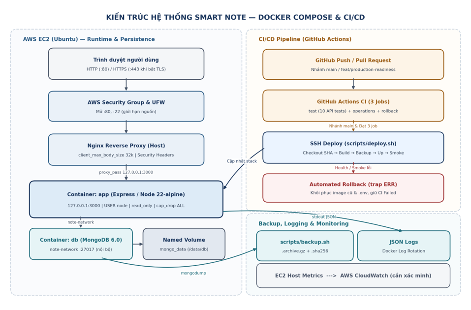
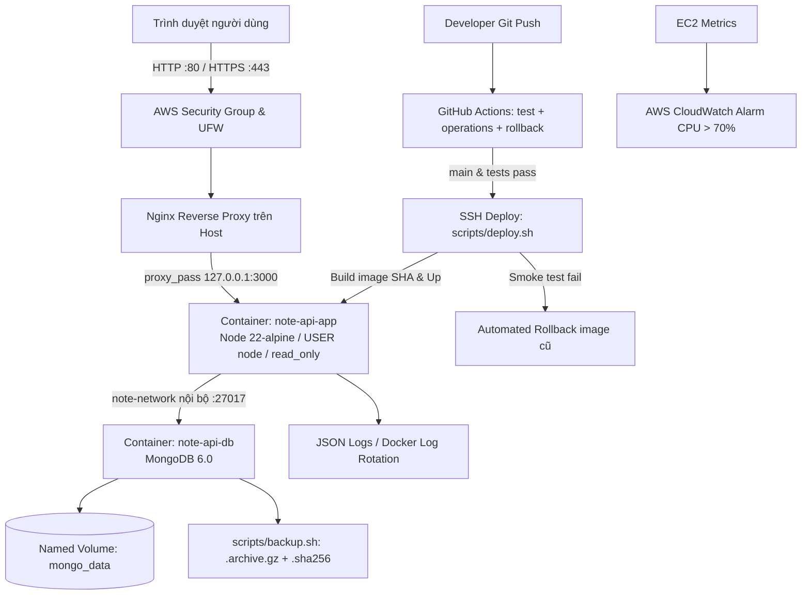

# Tiến hóa Kiến trúc Hệ thống Smart Note (Architecture Evolution)

Tài liệu này tổng hợp và phân tích kiến trúc hệ thống **Smart Note** qua các mốc phát triển đồ án DevOps 2026:

---

## 1. Các mốc Kiến trúc Hệ thống

* **[Kiến trúc Tuần 1: Khởi tạo Hạ tầng Ban đầu (Initial Deployment)](from-week-1/README.md)**
  * **Mô hình:** Bare-metal trên máy chủ ảo hóa AWS EC2 (Ubuntu 24.04).
  * **Quản lý tiến trình:** Quản lý bằng PM2, Web server Nginx reverse proxy cổng 80, database MongoDB cài trực tiếp trên máy chủ.
  * **Xem chi tiết:** [Phân tích kiến trúc Tuần 1](from-week-1/README.md) & [Sơ đồ kiến trúc Tuần 1](from-week-1/diagram.png).

* **[Kiến trúc Tuần 4: Hoàn thiện Vận hành — Docker Compose & CI/CD Pipeline (Final Production)](from-week-4/README.md)**
  * **Mô hình:** Container hóa 100% bằng **Docker Compose**, bảo mật container không đặc quyền (`USER node`, `read_only: true`, `cap_drop: [ALL]`), lưu trữ dữ liệu bền vững qua **Named Volume** (`mongo_data`).
  * **Tự động hóa:** Đường ống **GitHub Actions CI/CD** (10 automated API tests, kiểm thử vận hành, tự động rollback, SSH deployment).
  * **Vận hành:** Backup có mã băm `sha256sum`, JSON Log rotation, healthcheck & readiness check độc lập.
  * **Xem chi tiết:** [Phân tích kiến trúc Tuần 4](from-week-4/README.md) & [Sơ đồ kiến trúc Tuần 4](from-week-4/image.png).

---

## 2. Sơ đồ Kiến trúc Tổng thể Tuần 4 (Final Architecture)

---

## 3. Tổng kết Lợi ích Đạt được
1. **Cô lập và nhất quán:** Môi trường phát triển và môi trường vận hành được đồng nhất nhờ Dockerfile và Docker Compose.
2. **Tin cậy và phục hồi nhanh:** Dữ liệu an toàn qua named volume; pipeline có cơ chế tự động rollback ngăn chặn phiên bản lỗi.
3. **Bảo mật nhiều lớp:** Phân vùng mạng nội bộ, loại bỏ quyền root trên container, lọc cổng nghiêm ngặt từ UFW và Security Group.
