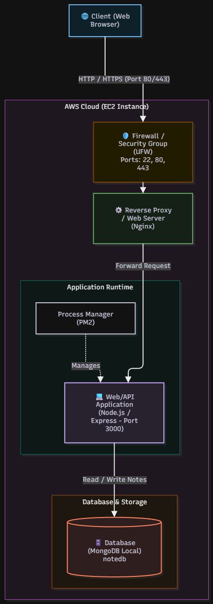

# Phân tích Kiến trúc Hệ thống Tuần 1 — Khởi tạo Hạ tầng Ban đầu (Initial Deployment)

## 1. Mô tả Tổng quan
Ở giai đoạn Tuần 1 (Week 1 Checkpoint), hệ thống **Smart Note Web App** được xây dựng và triển khai theo mô hình kiến trúc truyền thống **Client – Server ba lớp (3-Tier Architecture)** vận hành trực tiếp trên máy chủ ảo hóa **AWS EC2 (Ubuntu Server)** mà chưa áp dụng container hóa:
* **Tầng Client:** Trình duyệt người dùng (Web Browser) gửi yêu cầu HTTP/HTTPS qua mạng Internet.
* **Tầng Bảo mật & Network:** Tường lửa AWS Security Group kết hợp tường lửa hệ điều hành **UFW**.
* **Tầng Reverse Proxy:** Web server **Nginx** tiếp nhận và chuyển tiếp lưu lượng truy cập.
* **Tầng Application Runtime:** Ứng dụng Backend **Node.js / Express** lắng nghe tại cổng `3000`, được quản lý tiến trình bởi **PM2**.
* **Tầng Database:** Cơ sở dữ liệu **MongoDB** cục bộ (Local instance) lưu trữ cơ sở dữ liệu `notedb`.

---

## 2. Chi tiết các Thành phần Hạ tầng

### 2.1. Client (Trình duyệt người dùng)
* Người dùng mở trình duyệt, nhập địa chỉ **IP Public của máy chủ AWS EC2** (ví dụ `http://3.25.171.188`).
* Thao tác tạo mới, xem danh sách hoặc xóa ghi chú được đóng gói thành các HTTP Requests gửi đến máy chủ.

### 2.2. Network & Tường lửa (AWS Security Group & UFW)
* **AWS Security Group & UFW (Uncomplicated Firewall):** Đóng vai trò là bức tường phòng thủ lọc các cổng kết nối:
  * **Port 80 (HTTP) & Port 443 (HTTPS):** Mở công khai cho mọi nguồn (`0.0.0.0/0`) để tiếp nhận lưu lượng web.
  * **Port 22 (OpenSSH):** Mở có giới hạn phục vụ quản trị từ xa thông qua SSH.
  * Các cổng ứng dụng nội bộ (`3000`) và cổng database (`27017`) không được cấu hình cho phép truy cập từ Internet bên ngoài.

### 2.3. Reverse Proxy (Nginx Web Server)
* Nginx được cấu hình làm Reverse Proxy đón tiếp lưu lượng tại cổng 80.
* Sử dụng chỉ thị `proxy_pass http://localhost:3000` để chuyển tiếp các HTTP requests từ người dùng vào ứng dụng Backend Node.js đang chạy cục bộ trên máy chủ.
* Giúp che giấu kiến trúc backend thực tế, quản lý cổng tập trung và chuẩn bị sẵn sàng cho việc gắn chứng chỉ SSL/TLS.

### 2.4. Quản lý Tiến trình Ứng dụng (Node.js & PM2)
* Ứng dụng Backend được xây dựng bằng framework **Express.js**, lắng nghe tại cổng `3000`.
* **PM2 (Process Manager):** Đóng vai trò giám sát tiến trình 24/7 trên môi trường máy chủ:
  * Khởi chạy ứng dụng dưới dạng tiến trình nền (background daemon).
  * Tự động khởi động lại (auto-restart) ứng dụng nếu xảy ra crash hoặc lỗi unhandled exception.
  * Hỗ trợ tự động chạy lại ứng dụng cùng hệ điều hành sau khi máy chủ reboot (`pm2 startup`).

### 2.5. Cơ sở dữ liệu Cục bộ (Local MongoDB)
* Cài đặt MongoDB trực tiếp trên máy chủ Ubuntu qua `apt`.
* Lắng nghe mặc định tại cổng `27017` trên giao diện cục bộ.
* Backend kết nối qua chuỗi kết nối: `mongodb://127.0.0.1:27017/notedb`.
* Chịu trách nhiệm lưu trữ và truy vấn các bản ghi ghi chú.

---

## 3. Đánh giá Hạn chế của Kiến trúc Tuần 1

Mặc dù kiến trúc Tuần 1 đáp ứng được yêu cầu triển khai một ứng dụng hoạt động được (Working Application), hệ thống vẫn tồn tại các hạn chế kỹ thuật:
1. **Thiếu tính cô lập (Lack of Isolation):** Node.js, MongoDB và PM2 chạy trực tiếp trên cùng một hệ điều hành host, dễ dẫn đến xung đột phiên bản và khó khăn khi sao chép môi trường sang máy chủ khác.
2. **Quy trình triển khai thủ công (Manual Deployment):** Mỗi lần cập nhật code đòi hỏi kỹ sư phải SSH vào server, chạy `git pull`, `npm install` và `pm2 restart`, tiềm ẩn rủi ro sai sót do con người và không có cơ chế rollback tự động.
3. **Quản trị sao lưu dữ liệu phân tán:** Chưa có kịch bản sao lưu tự động tách biệt với không gian mã nguồn.

*Các hạn chế này là tiền đề để hệ thống được nâng cấp toàn diện sang mô hình **Container hóa Docker Compose và CI/CD Automation** từ Tuần 2 đến Tuần 4.*
