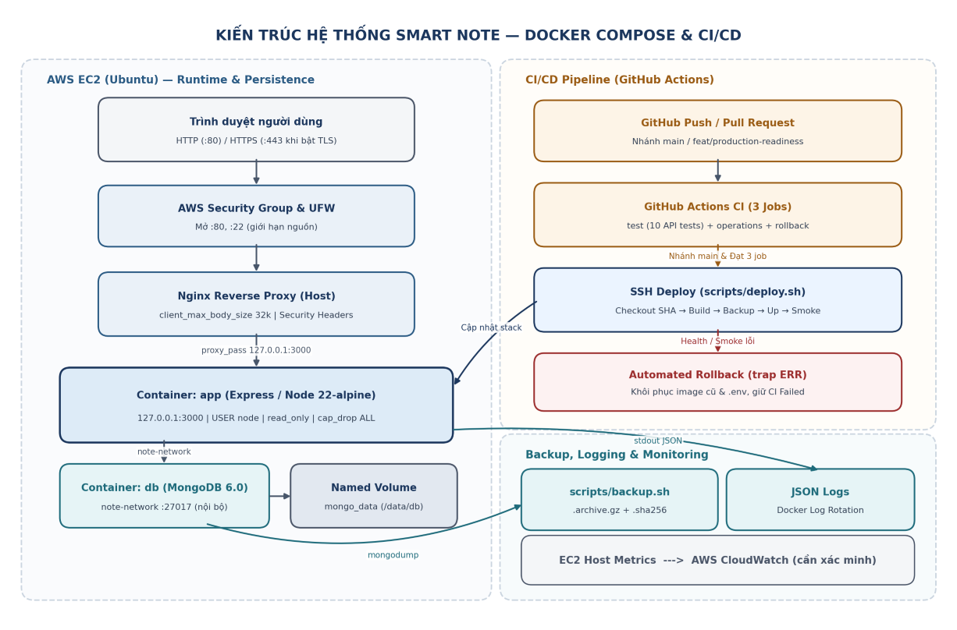

# Phân tích Kiến trúc Hệ thống Tuần 4 — Docker Compose & CI/CD Pipeline

## 1. Tổng quan Kiến trúc (Architecture Overview)

Kiến trúc **Tuần 4 (Final Architecture)** của dự án **Smart Note** đại diện cho giai đoạn hoàn thiện toàn diện về mặt DevOps: chuyển dịch hoàn toàn từ mô hình triển khai thủ công sang **hệ thống container hóa (Containerization) tự động hóa đầu-cuối (End-to-End CI/CD Automation)**, gia cố bảo mật nhiều tầng (Multi-layer Security Hardening), sao lưu toàn vẹn dữ liệu (Integrity-verified Backup) và cơ chế tự động phục hồi khi có sự cố (Automated Rollback).

Hệ thống được tổ chức thành **3 phân vùng chức năng chính**:
1. **AWS EC2 (Ubuntu) — Runtime & Persistence:** Môi trường vận hành ứng dụng và lưu trữ dữ liệu bền vững.
2. **CI/CD Pipeline (GitHub Actions):** Đường ống tự động hóa kiểm thử, đóng gói, triển khai và cứu hộ tự động.
3. **Backup, Logging & Monitoring:** Phân hệ sao lưu dữ liệu có mã băm toàn vẹn, thu thập log định dạng JSON và giám sát tài nguyên.

---

## 2. Phân tích chi tiết các Phân vùng Kiến trúc

### 2.1. Phân vùng Runtime & Persistence (AWS EC2)

* **Lớp mạng & Tường lửa (AWS Security Group & UFW):**
  * Tường lửa hai lớp kiểm soát chặt chẽ lưu lượng ra/vào máy chủ.
  * Chỉ mở công khai cổng **HTTP (`:80`)** và **HTTPS (`:443`)** cho người dùng Internet truy cập ứng dụng.
  * Cổng **SSH (`:22`)** được giới hạn truy cập phục vụ quản trị và kết nối tự động từ GitHub Actions runner.
  * **Tuyệt đối không publish** cổng cơ sở dữ liệu MongoDB (`27017`) hay cổng ứng dụng backend (`3000`) ra ngoài Internet.
* **Nginx Reverse Proxy (Chạy trực tiếp trên Host):**
  * Đóng vai trò là cổng đón tiếp duy nhất (Single Point of Entry) tiếp nhận mọi HTTP Request từ client.
  * Thiết lập giới hạn kích thước gói tin `client_max_body_size 32k` nhằm phòng chống tấn công DoS payload lớn.
  * Bổ sung các HTTP Security Headers (`X-Content-Type-Options: nosniff`, `X-Frame-Options: SAMEORIGIN`, `Referrer-Policy: no-referrer-when-downgrade`).
  * Thực hiện `proxy_pass` cục bộ tới địa chỉ loopback `127.0.0.1:3000` của container ứng dụng.
* **Container `app` (Node.js 22-alpine / Express):**
  * **Chỉ bind cổng nội bộ:** Docker mapping cổng theo dạng `127.0.0.1:3000:3000`, ngăn chặn hoàn toàn truy cập trực tiếp vượt mặt Reverse Proxy.
  * **Gia cố bảo mật Container (Hardening):**
    * Chạy dưới quyền người dùng không đặc quyền (`USER node`, UID/GID 1000), không chạy bằng `root`.
    * Áp dụng hệ thống tệp chỉ đọc (`read_only: true`), chỉ cấp quyền ghi tạm tại thư mục `/tmp` dạng `tmpfs`.
    * Loại bỏ toàn bộ Linux capabilities (`cap_drop: [ALL]`) để ngăn chặn nguy cơ leo thang đặc quyền (Privilege Escalation).
  * **Tách biệt Endpoints kiểm tra sức khỏe:**
    * `/live`: Kiểm tra tiến trình Node.js còn phản hồi HTTP hay không.
    * `/health`: Kiểm tra mức sẵn sàng thực tế (Readiness Check), chủ động `ping` tới MongoDB và trả về HTTP `503` nếu database chưa sẵn sàng; đồng thời phản hồi mã commit SHA đang phục vụ để đối chiếu với CI/CD.
* **Container `db` (MongoDB 6.0) & Named Volume (`mongo_data`):**
  * Nằm trọn vẹn trong mạng bridge nội bộ `note-network`, hoàn toàn không có mapping cổng ra host (`ports` để trống).
  * Chỉ các container cùng tham gia `note-network` (cụ thể là `app`) mới có thể phân giải tên miền nội bộ `db:27017` để kết nối.
  * Dữ liệu được ghi vào Docker Named Volume `mongo_data` gắn kết tại `/data/db`. Nhờ cơ chế tách biệt giữa Container và Storage, toàn bộ dữ liệu ghi chú được bảo toàn nguyên vẹn kể cả khi container bị xóa, tái tạo (`recreate`) hoặc cập nhật phiên bản mới.

---

### 2.2. Phân vùng CI/CD Pipeline (GitHub Actions)

Quy trình tự động hóa được chia tách thành các giai đoạn nghiêm ngặt để đảm bảo mã nguồn lỗi không bao giờ được đưa lên môi trường Production:

1. **Kích hoạt (Trigger):** Kích hoạt tự động khi có sự kiện `push` hoặc `pull_request` vào nhánh `main` (hoặc nhánh chuẩn bị phát hành `feat/production-readiness`).
2. **Kiểm thử tự động đa tầng (CI - 3 Jobs độc lập):**
   * **Job `test`:** Khởi tạo môi trường ảo với service container MongoDB thật, chạy bộ 10 bài kiểm thử tự động (`api.test.js`) bao quát kiểm tra logic CRUD, xác thực dữ liệu đầu vào, phòng chống XSS/HTML injection và kiểm tra phản hồi lỗi khi mất DB.
   * **Job `operations`:** Sử dụng Docker trong runner để chạy script `scripts/verify-operations.sh` trên project cô lập (`note-check-*`), diễn tập tự động quy trình backup, restore, xác thực checksum và xử lý 3 sự cố vận hành có chủ đích.
   * **Job `rollback`:** Thực thi `scripts/verify-rollback.sh`, mô phỏng trường hợp ứng dụng mới bị lỗi readiness (`/health` trả về `503`) để kiểm chứng khả năng tự động khôi phục về phiên bản cũ mà không làm mất dữ liệu.
3. **Triển khai tự động (CD - Job `deploy` qua SSH):**
   * Chỉ kích hoạt trên nhánh `main` khi **cả 3 job kiểm thử đều thành công**.
   * Kết nối tới máy chủ EC2 thông qua SSH Action bằng GitHub Secrets (`SERVER_HOST`, `SERVER_USER`, `SERVER_SSH_KEY`).
   * Thực thi `scripts/deploy.sh` với các nguyên tắc an toàn:
     * Checkout chính xác commit SHA từ pipeline.
     * Build Docker image mới trước khi chạm vào container cũ (Build-before-replace) để tránh downtime vô ích nếu lỗi build.
     * Tự động sao lưu dữ liệu database hiện hữu trước khi nâng cấp.
     * Khởi chạy stack mới bằng `docker compose up -d --wait`.
     * Chạy `scripts/smoke-test.sh` kiểm tra thực tế mã phản hồi và commit SHA trên `/health`.
4. **Cơ chế Cứu hộ tự động (Automated Rollback via `trap ERR`):**
   * Nếu quá trình khởi động hoặc smoke test thất bại, shell trap tự động bắt lỗi và hoàn nguyên ngay lập tức về image container và file cấu hình `.env` của phiên bản ổn định trước đó.
   * Đồng thời trả về mã lỗi (`exit 1`) để GitHub Actions đánh dấu pipeline ở trạng thái **Failed**, giúp kỹ sư nhận biết đợt triển khai không đạt yêu cầu.

---

### 2.3. Phân vùng Backup, Logging & Monitoring

* **Sao lưu dữ liệu định kỳ (`scripts/backup.sh`):**
  * Tương tác với container `note-api-db` thông qua công cụ `mongodump` của MongoDB.
  * Xuất dữ liệu dưới dạng luồng nén `.archive.gz` lưu trữ tại thư mục tách biệt bên ngoài repository (`/home/ubuntu/backups/`).
  * Tự động sinh file mã băm `.sha256` đi kèm để phục vụ kiểm tra tính toàn vẹn trước khi khôi phục (`scripts/restore.sh`).
* **Thu thập Log ứng dụng (JSON Logs & Log Rotation):**
  * Ứng dụng Express xuất log trực tiếp ra `stdout` theo chuẩn cấu trúc JSON (chứa method, path, status, duration, version, timestamp; không ghi dữ liệu nhạy cảm hoặc body).
  * Cấu hình Docker Log Rotation giới hạn tối đa `10MB` mỗi file và lưu tối đa `3` file xoay vòng (`max-size: "10m"`, `max-file: "3"`), triệt tiêu nguy cơ tràn ổ cứng máy chủ.
* **Giám sát hạ tầng (CloudWatch Metrics):**
  * Thu thập các chỉ số phần cứng cốt lõi của máy chủ EC2 (CPU Utilization, Network In/Out, Status Checks).
  * Cấu hình CloudWatch Alarm cảnh báo khi mức sử dụng CPU vượt quá `70%` liên tục trong 5 phút.

---

## 3. Ma trận Tiến hóa Kiến trúc: Tuần 1 vs Tuần 4

| Tiêu chí so sánh | Kiến trúc Tuần 1 (Initial Setup) | Kiến trúc Tuần 4 (Final Production) |
|---|---|---|
| **Mô hình triển khai** | Thủ công (Bare-metal trên host OS) | Đóng gói Container hóa với **Docker Compose** |
| **Quản lý tiến trình** | Quản lý bằng PM2 trên host | Quản lý vòng đời bởi **Docker Engine (`restart: always`)** |
| **Cơ sở dữ liệu** | MongoDB cài trực tiếp trên máy chủ Ubuntu | MongoDB đóng gói container, lưu trữ qua **Named Volume** |
| **Phân vùng mạng** | Chạy chung network không gian máy chủ | Tách biệt mạng bridge nội bộ **`note-network`** (cô lập DB) |
| **Bảo mật Container** | Tiến trình chạy với quyền user mặc định | **User `node`**, `read_only: true`, `cap_drop: [ALL]` |
| **Độ an toàn Reverse Proxy** | Cấu hình proxy cơ bản | Giới hạn payload `32k`, thêm **Security Headers** |
| **Quy trình Triển khai** | SSH thủ công, `git pull`, restart PM2 | **CI/CD GitHub Actions tự động hóa 100% qua commit** |
| **Kiểm thử chất lượng** | Kiểm thử thủ công bằng Postman / Browser | **10 Automated Tests**, kiểm thử vận hành & rollback tự động |
| **Sao lưu dữ liệu** | Chưa có cơ chế chuẩn hóa | Script **`mongodump` nén gzip kèm mã băm SHA256** |
| **Khả năng phục hồi** | Xử lý thủ công khi có lỗi | **Tự động Rollback** về phiên bản ổn định khi smoke test lỗi |

---

## 4. Kết luận

Kiến trúc Tuần 4 thể hiện sự trưởng thành vượt bậc về tư duy và thực hành DevOps:
* **Tính sẵn sàng và độ tin cậy cao:** Đảm bảo ứng dụng luôn có cơ chế kiểm tra sức khỏe thực chất, không bị mất dữ liệu nhờ volume bền vững và có quy trình cứu hộ tự động.
* **Tính lặp lại và nhất quán:** Mọi bước từ kiểm thử, đóng gói đến triển khai đều được định nghĩa thành mã (Infrastructure as Code & Pipeline as Code), cho phép tái lập môi trường bất kỳ lúc nào trên máy chủ mới sạch.
