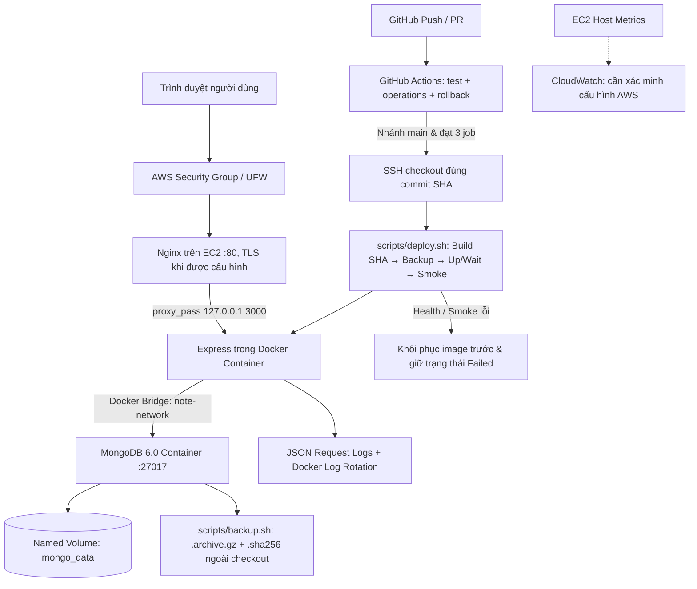

# Từ phát triển đến vận hành: Triển khai tự động và tin cậy ứng dụng Smart Note trên AWS EC2 với Docker Compose và GitHub Actions

**Môn học:** DevOps – Final Project 2026  
**Nhóm thực hiện:** Làng Xì Mi — Nguyễn Bá Toàn · Trần Tiến Minh · Hồ Thăng Bảo Huy  
**Repository:** https://github.com/batoannguyen52-debug/devops-note-api  
**Phiên bản báo cáo:** Hoàn thiện kỹ thuật (11/11/2026)

---

## Tóm tắt (Abstract)

Báo cáo trình bày quá trình thiết kế, container hóa, tự động hóa triển khai và hoàn thiện vận hành cho ứng dụng ghi chú **Smart Note** (Node.js/Express + MongoDB 6.0) trên máy chủ Ubuntu AWS EC2 trong 4 tuần. Hệ thống tiến hóa từ mô hình triển khai thủ công với PM2 (Tuần 1) lên kiến trúc container hóa bằng Docker Compose (Tuần 2–4), giữ Nginx trên host làm reverse proxy ở cổng `80` và chỉ mở cổng ứng dụng `3000` trên giao diện loopback `127.0.0.1`.

Pipeline GitHub Actions gồm 4 job (`test` → `operations` + `rollback` → `deploy`) tự động chạy 10 bài kiểm thử API với MongoDB thật, diễn tập sao lưu/khôi phục và 3 tình huống sự cố trong môi trường Compose cô lập, kiểm chứng cơ chế tự động khôi phục (rollback) khi phiên bản mới lỗi readiness, trước khi SSH checkout đúng commit SHA lên EC2. Script triển khai `scripts/deploy.sh` build image gắn SHA trước khi chạm vào dịch vụ đang chạy, sao lưu dữ liệu trước khi cập nhật, xác minh qua smoke test đối chiếu `version` trên `/health` và tự động hoàn nguyên image cũ nếu triển khai thất bại.

Hệ thống áp dụng gia cố container (`USER node`, `cap_drop: [ALL]`, `read_only: true`), cô lập mạng cơ sở dữ liệu, xuất log định dạng JSON kèm log rotation, sao lưu `mongodump` nén gzip có kiểm tra toàn vẹn `sha256sum` và cẩm nang xử lý sự cố (playbook) gồm 6 kịch bản (5 kịch bản đã thực nghiệm tự động). Báo cáo đồng thời phân tách minh bạch giữa các kết quả đã kiểm chứng trong môi trường cô lập/CI (GitHub Actions run `42968497856`, commit `6c5ce09`) với các cấu hình hạ tầng AWS (CloudWatch, cron, TLS, deploy nhánh hoàn thiện lên EC2) cần xác minh trực tiếp trên tài khoản triển khai.

**Từ khóa:** DevOps, CI/CD, Docker Compose, GitHub Actions, AWS EC2, MongoDB, Healthcheck, Automated Rollback, Backup & Restore, Troubleshooting.

---

## 1. Giới thiệu

### 1.1. Bối cảnh, mục tiêu và phạm vi
Ngay cả với một ứng dụng web quy mô nhỏ, việc triển khai thủ công qua SSH vẫn tiềm ẩn nhiều rủi ro vận hành: chạy sai phiên bản commit, bỏ qua kiểm thử tự động, kiểm tra sức khỏe bằng phản hồi tĩnh không phát hiện được lỗi cơ sở dữ liệu, và sao lưu không kiểm tra mã lỗi thoát hay tính toàn vẹn tệp. Mục tiêu của đồ án là xây dựng quy trình DevOps đầu-cuối cho ứng dụng **Smart Note**, tập trung vào khả năng tái tạo triển khai từ máy chủ sạch, tự động chặn mã lỗi, truy vết phiên bản đang phục vụ, bảo vệ dữ liệu và phục hồi nhanh sau sự cố.

- **Phạm vi chức năng:** Giao diện web tĩnh `GET /` (Dark/Light mode, tìm kiếm, lọc theo 5 chuyên mục) và REST API `GET /notes`, `POST /notes`, `DELETE /notes/:id`; điểm cuối liveness `GET /live` và readiness `GET /health` (gửi lệnh `ping` thực tới MongoDB và trả về `version` SHA đang chạy). Ứng dụng là mô hình demo dùng chung dữ liệu thực nghiệm, chưa tích hợp tài khoản hay phân quyền người dùng.
- **Môi trường hạ tầng:** Máy chủ AWS EC2 chạy Ubuntu (vùng `ap-southeast-2`, kiến trúc `x86_64` hỗ trợ AVX cho MongoDB 6.0; IP công khai ghi nhận ở Tuần 1 là `3.25.171.188`), khuyến nghị tối thiểu 2 GB RAM và 16 GB ổ đĩa cho tác vụ build tại host.
- **Công nghệ sử dụng:** Node.js `22-alpine` (`engines: >=22.21.0`), `express ^5.3.0`, `mongoose ^9.11.4`, `jest ^30.5.2`, `supertest ^7.3.1`, `mongodb-memory-server ^11.3.0`, MongoDB `6.0`, Nginx, UFW, Docker Engine & Docker Compose v2, GitHub Actions (`appleboy/ssh-action@v1.2.0`), Bash scripts.

### 1.2. Lộ trình 4 tuần và phân công thành viên

*Bảng 1. Tóm tắt lộ trình 4 tuần thực hiện đồ án*

| Tuần | Nội dung chính | Minh chứng trong repository |
|---|---|---|
| **Week 1** | Dựng AWS EC2 Ubuntu, cấu hình tường lửa UFW (`22`, `80`, `443`), Nginx reverse proxy, chạy ứng dụng Node.js bằng PM2 (`note-api`) và kết nối MongoDB. | [`evidence/week-1/README.md`](../evidence/week-1/README.md), `report1.png` → `report1.3.png` |
| **Week 2** | Đóng gói `Dockerfile`, `docker-compose.yml` (named volume `mongo_data`), xây dựng pipeline GitHub Actions tự động test và deploy; kiểm chứng persistence và cơ chế fail pipeline. | [`automated-deployment.md`](../evidence/week-2/automated-deployment/automated-deployment.md), [`fail-pipeline.md`](../evidence/week-2/fail-pipeline/fail-pipeline.md), `database-persistence/` |
| **Week 3** | Tách `/live` và `/health`, structured JSON logging + log rotation, gia cố bảo mật container, viết `backup.sh`/`restore.sh` có SHA-256, `backup.cron` và cẩm nang xử lý sự cố. | [`evidence/week-3/playbook.md`](../evidence/week-3/playbook.md), [`docs/operations/README.md`](operations/README.md), `scripts/`, `config/` |
| **Week 4** | Hợp nhất hệ thống, bổ sung job `operations` và `rollback` trong CI, hoàn thiện hướng dẫn dựng server sạch (`docs/deployment.md`), kịch bản demo/Q&A (`docs/demo.md`) và báo cáo kỹ thuật. | [`evidence/week-4/README.md`](../evidence/week-4/README.md), `api-tests.txt`, `operations-test.txt`, `rollback-ci.txt`, `dependency-audit.txt` |

*Bảng 2. Phân công nhiệm vụ ban đầu của nhóm Làng Xì Mi*

| Thành viên | Vai trò khởi tạo (theo tài liệu nhóm) | Ghi chú xác minh cuối kỳ |
|---|---|---|
| **Nguyễn Bá Toàn** | Thiết lập AWS EC2, cấu hình Nginx reverse proxy và tường lửa UFW. | Nhóm cần đối chiếu trực tiếp các thay đổi hoàn thiện và xác minh hạ tầng AWS trước bảo vệ. |
| **Trần Tiến Minh** | Phát triển Backend API (`server.js`) và bộ kiểm thử tự động (`api.test.js`). | Nắm vững hợp đồng API, validation, cơ chế readiness và bộ 10 test cases. |
| **Hồ Thăng Bảo Huy** | Quản trị MongoDB, xây dựng sao lưu/khôi phục và hỗ trợ CI/CD GitHub Actions. | Thực hiện commit deploy tự động Tuần 2 (`BaoHuy903`), nắm vững luồng backup/restore và pipeline. |

---

## 2. Kiến trúc hệ thống

### 2.1. Sơ đồ kiến trúc hoàn chỉnh



*Hình 1. Sơ đồ kiến trúc hiện tại của hệ thống Smart Note với Docker Compose và CI/CD (sơ đồ lịch sử Tuần 1 chạy PM2 được lưu tại [`docs/architecture/diagram.png`](architecture/diagram.png)).*

### 2.2. Luồng xử lý yêu cầu và mô tả các thành phần
1. **Trình duyệt → Security Group / UFW → Nginx (`:80`):** Nginx chạy trực tiếp trên host Ubuntu, giới hạn `client_max_body_size 32k`, gắn các header bảo mật (`X-Content-Type-Options: nosniff`, `Referrer-Policy: same-origin`), chuyển tiếp lưu lượng tới `http://127.0.0.1:3000` với `proxy_connect_timeout 5s` và `proxy_read_timeout 15s`.
2. **Container `app` → Container `db`:** Express phục vụ giao diện `public/index.html` và REST API; chạy bằng user `node` trong môi trường chỉ đọc (`read_only: true`). Mongoose giao tiếp với container MongoDB qua tên dịch vụ DNS `db:27017` trong mạng bridge nội bộ `note-network`.
3. **Lưu trữ bền vững (`mongo_data`):** Named volume `mongo_data` gắn vào `/data/db` của container `db`, tách biệt dữ liệu khỏi vòng đời container. Thư mục triển khai trên EC2 được cố định là `/home/ubuntu/devops-note-api` để tiền tố tên project Compose không thay đổi và luôn gắn đúng volume cũ.
4. **Sao lưu và Quan sát:** `scripts/backup.sh` stream bản dump nén gzip ra thư mục `/home/ubuntu/backups` kèm tệp `.sha256`. Container xuất JSON log có xoay vòng dung lượng qua Docker logging driver.

### 2.3. Quy hoạch cổng dịch vụ và phạm vi truy cập

*Bảng 3. Quy hoạch cổng mạng trên máy chủ AWS EC2*

| Cổng | Dịch vụ | Lắng nghe trên | Mở ra Internet (SG/UFW) | Lý do thiết kế |
|---|---|---|---|---|
| `22` | OpenSSH | Mọi interface | **Giới hạn nguồn** | Quản trị server và runner deploy; cần giới hạn allowlist khi có thể, tránh khóa phiên SSH hiện tại. |
| `80` | Nginx Reverse Proxy | Mọi interface | **Có** | Cổng HTTP công khai duy nhất phục vụ trình duyệt người dùng. |
| `443` | Nginx HTTPS (dự phòng) | Mọi interface | Tùy cấu hình TLS | Chỉ có hiệu lực bảo mật khi đã cấu hình domain và chứng chỉ TLS thực tế. |
| `3000` | Container `app` (Express) | `127.0.0.1` | **Không** | Chỉ cho phép Nginx trên cùng host EC2 gọi vào qua loopback. |
| `27017` | Container `db` (MongoDB) | Mạng nội bộ `note-network` | **Không** | Không publish cổng ra host; chỉ container `app` trong mạng nội bộ truy cập được. |

---

## 3. Containerization

### 3.1. Thiết kế `Dockerfile`
`Dockerfile` sử dụng base image `node:22-alpine` với `NODE_ENV=production` nhằm tối ưu kích thước và giảm bề mặt tấn công:
- **Tối ưu cache và build context:** Tệp `.dockerignore` loại trừ `node_modules`, `.git`, `.env*`, `evidence`, `docs`, `work`, `coverage` và `*.log`. Chỉ `package.json` và `package-lock.json` được sao chép trước để tận dụng layer cache khi chạy `npm ci --omit=dev --ignore-scripts && npm cache clean --force`.
- **Quyền thực thi tối thiểu:** Chỉ sao chép mã nguồn cần thiết (`server.js` và thư mục `public/`) với quyền sở hữu `--chown=node:node`, sau đó chuyển sang `USER node` trước khi khởi chạy `CMD ["node", "server.js"]`.

### 3.2. Thiết kế `docker-compose.yml` và chứng minh Persistence
- **Phụ thuộc khởi động và Healthcheck:** Service `db` (`mongo:6.0`) có healthcheck gọi `mongosh --quiet --eval "quit(db.adminCommand('ping').ok ? 0 : 1)"` mỗi 10 giây (`start_period: 20s`, `retries: 5`). Service `app` cấu hình `depends_on: db (condition: service_healthy)` và tự kiểm tra sức khỏe mỗi 10 giây bằng `node -e "fetch('http://127.0.0.1:3000/health', ...)"`.
- **Gia cố vận hành:** Service `app` bật `init: true`, `restart: unless-stopped`, `security_opt: [no-new-privileges:true]`, `cap_drop: [ALL]`, `read_only: true` và `tmpfs: [/tmp]`. Cả hai container dùng chung cấu hình log rotation (`json-file`, `max-size: "10m"`, `max-file: "3"`).
- **Kiểm chứng Persistence (`evidence/week-2/automated-deployment/`):** Trước khi cập nhật giao diện, nhóm tạo sẵn một ghi chú trên bản giao diện nền trắng Tuần 1. Sau khi đẩy commit `fix ui` lên nhánh `main` để GitHub Actions tự động build và thay thế container sang giao diện Dark Mode, bản ghi cũ vẫn hiển thị nguyên vẹn trên ứng dụng nhờ volume `mongo_data`.

---

## 4. CI/CD Pipeline

### 4.1. Luồng 4 Job trong `.github/workflows/deploy.yml`
Workflow cấu hình quyền tối thiểu `permissions: { contents: read }` và chống xung đột triển khai đồng thời qua `concurrency: { group: note-api-${{ github.ref }}, cancel-in-progress: false }`. Pipeline kích hoạt trên `push` (nhánh `main`, `feat/production-readiness`), `pull_request` vào `main`, hoặc `workflow_dispatch`:

1. **Job `test`:** Khởi chạy service container `mongo:6.0` có healthcheck, cài đặt phụ thuộc bằng `npm ci --ignore-scripts`, chạy `npm test` với 10 kiểm thử API trên database tạm `notedb_test`, đồng thời kiểm tra cú pháp toàn bộ shell scripts (`bash -n scripts/*.sh`) và xác thực tệp Compose (`docker compose config --quiet`).
2. **Job `operations`:** Build image `devops-note-api:review` và chạy `scripts/verify-operations.sh` trên Compose project cô lập `note-check-${{ github.run_id }}` (tự tạo container/volume/cổng riêng rồi dọn sạch sau khi chạy). Job kiểm chứng đầy đủ backup/restore, từ chối checksum hỏng và 3 tình huống sự cố, sau đó tải lên artifact `operations-evidence` (lưu 30 ngày).
3. **Job `rollback`:** Chạy `scripts/verify-rollback.sh` trên project cô lập `note-check-rollback-${{ github.run_id }}` để kiểm chứng cơ chế tự động hoàn nguyên khi triển khai image lỗi readiness, tải lên artifact `rollback-evidence`.
4. **Job `deploy`:** Chỉ chạy trên nhánh `main` (loại trừ `pull_request`) khi cả 3 job `test`, `operations` và `rollback` đều thành công (`needs: [test, operations, rollback]`). Job dùng `appleboy/ssh-action@v1.2.0` SSH vào EC2, chạy `git -c core.fileMode=false checkout --detach "$DEPLOY_SHA"` và thực thi `sudo bash scripts/deploy.sh "$DEPLOY_SHA"`.


*Hình 2. Pipeline GitHub Actions tự động kiểm thử và triển khai commit cập nhật giao diện lên AWS EC2 (`evidence/week-2/automated-deployment/`).*


*Hình 3. Khi bài kiểm thử không đạt, job `test` báo thất bại và chặn hoàn toàn bước triển khai lên production (`evidence/week-2/fail-pipeline/`).*

### 4.2. Cơ chế Deploy an toàn và Automated Rollback (`scripts/deploy.sh`)
Kịch bản `scripts/deploy.sh` đảm bảo triển khai chính xác phiên bản và giảm thiểu rủi ro sập dịch vụ:
- **Khóa tiến trình và xác thực SHA:** Kiểm tra tham số là commit SHA 40 ký tự hợp lệ khớp `git rev-parse HEAD`; sử dụng `flock -n 9` trên `/tmp/devops-note-api-deploy.lock` để ngăn hai lần deploy chạy chồng lấn ngay cả khi kích hoạt thủ công ngoài Actions.
- **Build trước khi thay container:** Lưu lại image ID và `APP_VERSION` của container `app` hiện tại, sau đó build `devops-note-api:$version`. Nếu bước build gặp lỗi, ứng dụng cũ vẫn tiếp tục phục vụ không bị gián đoạn.
- **Sao lưu trước khi nâng cấp & Smoke test:** Tự động chạy `scripts/backup.sh` nếu container `db` đang hoạt động, cập nhật stack bằng `docker compose up -d --no-build --wait --wait-timeout 120`, rồi gọi `scripts/smoke-test.sh` xác minh `/health` (đúng `version` SHA và `database: "up"`), `/notes` trả mảng JSON và `/` trả HTTP 200.
- **Lưu trạng thái nguyên tử & Rollback tự động:** Chỉ sau khi smoke test đạt, `APP_IMAGE` và `APP_VERSION` mới được ghi vào `.env` qua `os.replace`. Nếu quá trình `up --wait` hoặc smoke test lỗi, `trap rollback ERR` gắn tag `devops-note-api:rollback` cho image cũ, dựng lại container cũ, cập nhật `.env` và vẫn thoát với mã `1` để pipeline báo đỏ.

---

## 5. Giám sát, quan sát hệ thống và tra cứu log

### 5.1. Tách biệt Liveness/Readiness và Structured JSON Logging
- **`GET /live` (Liveness):** Trả `200 OK` kèm `version` ngay khi tiến trình Node.js phản hồi được HTTP.
- **`GET /health` (Readiness):** Gắn header `Cache-Control: no-store`, kiểm tra `mongoose.connection.readyState === 1` và gửi lệnh `admin().ping({ timeoutMS: 2000 })` tới MongoDB. Nếu DB sẵn sàng trả `200` (`{"status":"OK","database":"up","version":"..."}`); nếu DB lỗi trả `503` (`{"status":"DEGRADED","database":"down"}`). Đồng thời `mongoose.set('bufferCommands', false)` giúp mọi yêu cầu tới `/notes` trả `503` ngay lập tức thay vì treo request khi mất DB.
- **JSON Request Logs:** Mọi request ngoài môi trường test đều ghi một dòng JSON chuẩn gồm `time`, `method`, `path`, `status`, `durationMs` và `version` — tuyệt đối không ghi nội dung request body, chuỗi kết nối DB hay thông tin nhạy cảm. Docker giới hạn dung lượng log ở mức `10 MB × 3 tệp` cho mỗi container.

### 5.2. Giám sát hạ tầng và Trạng thái AWS CloudWatch
- **Kiểm tra trực tiếp trên host:** Vận hành viên sử dụng `docker compose ps`, `curl -i http://localhost/health`, `docker stats --no-stream`, `df -h`, `free -m` và `/var/log/nginx/error.log`.
- **Cấu hình CloudWatch (cần xác minh trực tiếp trên AWS):** Tài liệu [`docs/operations/README.md`](operations/README.md) quy định rõ quy trình tạo CloudWatch Alarm trên vùng `ap-southeast-2` cho chỉ số `CPUUtilization` (Statistic `Average`, period 5 phút, ngưỡng `>70%`, `2/2` datapoints, missing data đặt `missing`) gắn với SNS topic để gửi thông báo. Chỉ số RAM/disk yêu cầu cài đặt thêm **CloudWatch Agent** và IAM role phù hợp. *Lưu ý trung thực: do phiên hoàn thiện chưa có quyền truy cập trực tiếp tài khoản AWS, hạng mục alarm/agent/SNS được đánh dấu là cần xác minh thực tế trước buổi bảo vệ.*

### 5.3. Cách tra cứu nhật ký ứng dụng theo thời gian
Toàn bộ log ứng dụng và cơ sở dữ liệu được Docker thu thập qua stdout/stderr với định dạng JSON, hỗ trợ truy vấn nhanh theo thời gian và lọc lỗi:

```bash
cd /home/ubuntu/devops-note-api
# Xem log 10 phút gần nhất của app
sudo docker compose logs --timestamps --since 10m app
# Xem 50 dòng log mới nhất của cả app và db
sudo docker compose logs --tail 50 app db
# Lọc các request trả mã lỗi 4xx hoặc 5xx trong 1 giờ qua
sudo docker compose logs --since 1h app | grep -E '"status":(4|5)[0-9]{2}'
# Kiểm tra log lỗi tầng Nginx reverse proxy
sudo tail -n 50 /var/log/nginx/error.log
```

---

## 6. Bảo mật

1. **Firewall và Cô lập mạng:** Tường lửa UFW (đã xác minh `active` ở Tuần 1, `evidence/week-1/report1.png`) và AWS Security Group chỉ mở cổng `80` (HTTP) cho người dùng và cổng `22` (SSH) cho quản trị/deploy. Cổng `3000` chỉ bind vào `127.0.0.1`; cổng MongoDB `27017` chỉ tồn tại trong mạng Docker `note-network` và không ánh xạ ra host.
2. **Quản lý Secrets:** Thông tin truy cập máy chủ (`SERVER_HOST`, `SERVER_USER`, `SERVER_SSH_KEY`) được lưu tại GitHub Actions Secrets, không ghi vào mã nguồn hay ảnh minh chứng. Tệp `.env` (quyền `600`) và thư mục `backups/` bị chặn bởi `.gitignore` và `.dockerignore`.
3. **Gia cố Container & Phòng thủ tầng ứng dụng:** Container `app` chạy user `node`, bỏ toàn bộ Linux capabilities (`cap_drop: [ALL]`), đặt `no-new-privileges:true`, hệ thống tệp chỉ đọc (`read_only: true`) và không mount Docker socket. Backend tắt header `x-powered-by`, giới hạn JSON body `32kb`, kiểm tra chặt kiểu dữ liệu và độ dài (`title ≤ 200`, `content ≤ 10000`, `category ≤ 50`), chặn client tự gán `_id`/`createdAt`, và kiểm tra `ObjectId` hợp lệ trước khi xóa. Giao diện `public/index.html` áp dụng hàm `escapeHtml()` cho cả tiêu đề, nội dung lẫn chuyên mục để ngăn XSS.
4. **Kiểm tra lỗ hổng phụ thuộc:** Kết quả `npm audit --omit=dev` ghi nhận `found 0 vulnerabilities` cho các thư viện chạy trên môi trường production tại thời điểm kiểm tra (`evidence/week-4/dependency-audit.txt`).

---

## 7. Backup và Restore

### 7.1. Chiến lược sao lưu (`scripts/backup.sh`) và lịch chạy (`config/backup.cron`)
- **Cơ chế stream trực tiếp và toàn vẹn:** Script đặt `umask 077`, tạo tệp tạm có dấu thời gian UTC ngoài thư mục Git (`/home/ubuntu/backups/db_backup_YYYY-MM-DD_HH-MM-SS_XXXXXX.archive.gz`), chạy `docker compose exec -T db mongodump --db "$DB_NAME" --archive --gzip > "$archive"`, xác nhận tệp không rỗng (`test -s`) rồi sinh tệp kiểm tra `.sha256`. Nếu xảy ra bất kỳ lỗi nào, `trap ERR` xóa ngay tệp dở dang và trả mã thoát khác 0.
- **Lịch tự động và mục tiêu RPO:** Tệp mẫu `config/backup.cron` đặt lịch chạy lúc `02:00` hằng ngày (`/etc/cron.d/note-api-backup`), ghi log vào `/var/log/note-api-backup.log`. Mục tiêu **RPO 24 giờ** chỉ có giá trị vận hành sau khi cron được cài đặt và theo dõi chạy thành công trên EC2.

### 7.2. Quy trình khôi phục (`scripts/restore.sh`) và kết quả kiểm chứng
`scripts/restore.sh` yêu cầu bắt buộc biến môi trường `CONFIRM_RESTORE=yes` và sự tồn tại của cả tệp `.archive.gz` lẫn `.sha256`. Script thực hiện theo trình tự an toàn:
1. Kiểm tra chữ ký `sha256sum -c` và ping MongoDB **trước khi** tác động tới ứng dụng đang chạy.
2. Dừng container `app` (`docker compose stop app`) để tránh xung đột ghi đồng thời trong lúc khôi phục; cài `trap EXIT` tự động nỗ lực bật lại `app` nếu xảy ra lỗi giữa chừng.
3. Chạy `mongorestore --archive --gzip --drop --stopOnError --nsInclude "$DB_NAME.*"` và khởi động lại `app` chờ tới khi `healthy`.

**Kết quả thực nghiệm ngày 11/11/2026 (`evidence/week-4/operations-test.txt`):**
- Tạo ghi chú thử nghiệm `{"title":"restore-proof","content":"isolated recovery test","category":"DevOps"}`, chạy `backup.sh` thành công (`done dumping notedb.notes (1 document)`).
- Xóa bản ghi qua API `DELETE /notes/:id`, chạy `CONFIRM_RESTORE=yes bash scripts/restore.sh <archive>`: khôi phục `1 document(s) restored successfully. 0 document(s) failed`, truy vấn lại `GET /notes` khớp chính xác cả `_id` lẫn `content` gốc.
- **Kiểm thử bản backup hỏng:** Nối chuỗi `corrupt` vào cuối tệp `.archive.gz` rồi chạy `restore.sh` → `sha256sum` báo `FAILED`, script từ chối khôi phục trước khi dừng app, và `smoke-test.sh` xác nhận ứng dụng vẫn truy cập bình thường.

---

## 8. Xử lý sự cố (Troubleshooting)

### 8.1. Phương pháp khoanh vùng nhanh (Triage)
Playbook (`evidence/week-3/playbook.md`) xây dựng quy trình chẩn đoán nhanh dựa trên sự khác biệt giữa Nginx (`:80`), `/health` và `/live` (`:3000`):

*Bảng 4. Bảng khoanh vùng nhanh nguyên nhân sự cố*

| Qua Nginx (`:80/health`) | Trực tiếp `:3000/live` | Trực tiếp `:3000/health` | Ý nghĩa chẩn đoán | Mục Playbook |
|---|---|---|---|---|
| `502 Bad Gateway` | Không kết nối được | Không kết nối được | Container `app` dừng, crash hoặc sai cổng | Mục 1 |
| `503 Service Unavailable` | `200 OK` | `503 DEGRADED` | Tiến trình app còn sống nhưng DB dừng hoặc sai `MONGO_URI` | Mục 2, 3 |
| `502` / Timeout | `200 OK` | `200 OK` | App và DB khỏe; lỗi ở cấu hình Nginx, UFW hoặc Security Group | Triage / Nginx |
| Không đổi `version` / CI đỏ | `200 OK` (bản cũ) | `200 OK` (bản cũ) | Deploy thất bại và đã tự động rollback về image trước đó | Mục 6 |

### 8.2. Tổng hợp 6 kịch bản trong `evidence/week-3/playbook.md`

*Bảng 5. Tổng hợp các kịch bản xử lý sự cố đã thực nghiệm và hướng dẫn dự phòng*

| Sự cố (Incident) | Triệu chứng & Nguyên nhân | Cách khắc phục & Phòng tránh | Trạng thái kiểm chứng |
|---|---|---|---|
| **1. Container `app` dừng** | Mất kết nối cổng `3000`; qua Nginx báo `502`. Nguyên nhân thực nghiệm: `docker compose stop app`. | Chạy `docker compose up -d --no-build --wait app` và `smoke-test.sh`. Phòng tránh: `restart: unless-stopped`, giám sát endpoint ngoài. | **Đã thực nghiệm** (`operations-test.txt`) |
| **2. Container `db` dừng** | `/health` trả `503`, `/live` vẫn `200`, `backup.sh` báo lỗi `service "db" is not running`. Nguyên nhân: `docker compose stop db`. | Chạy `docker compose up -d --no-build --wait`, kiểm tra lại dữ liệu; **tuyệt đối không xóa volume** và không restore khi dữ liệu không hỏng. | **Đã thực nghiệm** (`operations-test.txt`) |
| **3. Sai `MONGO_URI`** | Container `app` `unhealthy`, log JSON báo `database_connection_failed`. Nguyên nhân: đặt URI trỏ tới host `missing-db`. | Sửa `.env` về `mongodb://db:27017/notedb` và **recreate** bằng `up -d --no-build --wait app` (`restart` không nạp biến môi trường mới). | **Đã thực nghiệm** (`operations-test.txt`) |
| **4. Tệp backup hỏng** | `restore.sh` trả lỗi `sha256sum: WARNING: 1 computed checksum did NOT match`. Nguyên nhân: archive bị thay đổi byte sau sao lưu. | Giữ tệp hỏng để điều tra, chọn bản backup hợp lệ khác; không tự tạo lại checksum cho tệp lỗi. | **Đã thực nghiệm** (`operations-test.txt`) |
| **5. Deploy bản lỗi readiness** | Pipeline đỏ, container candidate `unhealthy`. Thực nghiệm tiêm server giả lập luôn trả `503`. | `deploy.sh` tự hoàn nguyên image cũ, giữ nguyên dữ liệu và `.env`; sửa lỗi trên nhánh riêng rồi deploy lại bằng commit SHA đã kiểm chứng. | **Đã thực nghiệm CI** (`rollback-ci.txt`, Run `42968497856`) |
| **6. Quá tải CPU / đầy ổ đĩa** | Phản hồi chậm, CPU cao hoặc lỗi `no space left on device`. | Kiểm tra `docker stats`, `df -h`, `df -i`, `docker system df`; dọn tài nguyên có chọn lọc, tránh `prune -a` làm mất image rollback. | **Hướng dẫn dự phòng** (chưa gây tải thực) |

---

## 9. Đánh giá và hạn chế

### 9.1. Tổng hợp số liệu kiểm chứng và những điểm đã làm tốt

*Bảng 6. Các số liệu đã kiểm chứng từ repository và log thực nghiệm*

| Hạng mục | Kết quả đo / kiểm chứng | Nguồn xác minh trong repository |
|---|---|---|
| **Bộ kiểm thử API tự động** | **10/10 tests pass** trong `1.221s` (`jest --runInBand`) | [`evidence/week-4/api-tests.txt`](../evidence/week-4/api-tests.txt) |
| **Kiểm tra lỗ hổng thư viện** | `npm audit --omit=dev`: **0 vulnerabilities** | [`evidence/week-4/dependency-audit.txt`](../evidence/week-4/dependency-audit.txt) |
| **Triển khai tự động Tuần 2** | **1 phút 16 giây** (Test + Deploy, giữ nguyên dữ liệu cũ) | [`automated-deployment.md`](../evidence/week-2/automated-deployment/automated-deployment.md) |
| **Backup → Xóa → Restore** | Khôi phục khớp cả `_id` và `content`; từ chối tệp hỏng trước khi dừng app | [`evidence/week-4/operations-test.txt`](../evidence/week-4/operations-test.txt) |
| **Diễn tập 3 sự cố vận hành** | App stopped, DB stopped (`503`), sai `MONGO_URI`: phát hiện & phục hồi 3/3 | [`evidence/week-4/operations-test.txt`](../evidence/week-4/operations-test.txt) |
| **Kiểm thử Automated Rollback** | Từ chối candidate `503`, phục hồi version `6c5ce098...`, dữ liệu và `.env` | [`evidence/week-4/rollback-ci.txt`](../evidence/week-4/rollback-ci.txt) (Actions Run `42968497856`) |

**Những điểm hệ thống đã làm tốt:**
- **Tự động hóa kiểm thử vận hành ngay trong CI:** Không chỉ chạy unit/API test, pipeline còn tự động kiểm chứng backup/restore, 3 sự cố và quy trình rollback trên môi trường Docker cô lập ở mỗi lần push/PR.
- **Triển khai an toàn, truy vết rõ ràng:** Gắn tag image theo commit SHA, build trước khi thay container, sao lưu trước khi nâng cấp, đối chiếu `version` trên `/health` và tự động rollback khi thất bại.
- **Minh bạch chứng cứ:** Phân định rạch ròi giữa kết quả thực nghiệm tự động trong CI và các cấu hình hạ tầng thực tế trên AWS.

### 9.2. Hạn chế hiện tại, mục cần xác minh trên AWS và hướng phát triển
**Các hạn chế kỹ thuật hiện hữu:**
1. **Điểm lỗi đơn (Single Point of Failure) và chưa đạt zero-downtime:** Toàn bộ stack chạy trên một instance EC2 với một container `app`; quá trình thay container mới vẫn có khoảng gián đoạn ngắn.
2. **Phạm vi rollback giới hạn ở tầng ứng dụng:** `deploy.sh` khôi phục image và `.env` cũ, không tự động hoàn tác thay đổi schema dữ liệu hay cấu hình Nginx/hạ tầng.
3. **Backup nằm trên cùng máy chủ EC2:** Bảo vệ tốt trước lỗi thao tác dữ liệu nhưng chưa chống được kịch bản mất toàn bộ instance hoặc hỏng EBS volume.
4. **Thiếu xác thực người dùng, HTTPS và vòng đời MongoDB 6.0:** Ứng dụng chưa có authentication/authorization và chưa cấu hình TLS; `mongo:6.0` được giữ để tương thích dữ liệu hiện hữu nhưng đã hết vòng đời hỗ trợ (EOL); các base image/Actions hiện dùng version tag thay vì pin theo digest/commit SHA.
5. **Chưa có kiểm thử chịu tải:** Thực nghiệm mới xác minh trên dữ liệu nhỏ, chưa đo thông lượng/độ trễ dưới tải cao (k6/JMeter).

**Các mục cần xác minh trực tiếp trên AWS trước khi bảo vệ:**
- Cài đặt và kiểm thử nhận thông báo từ CloudWatch Alarm/SNS (và CloudWatch Agent nếu giám sát RAM/disk).
- Cài đặt thực tế `/etc/cron.d/note-api-backup` trên EC2 và kiểm tra tệp backup tạo theo lịch.
- Hợp nhất nhánh hoàn thiện vào `main` trên repository gốc (nhánh review chưa push trực tiếp do giới hạn quyền HTTP 403), chạy deploy thật và đối chiếu commit SHA trên `/health`.

**Hướng phát triển:** Bổ sung tên miền và TLS (HTTPS), đẩy bản sao lưu định kỳ ra Amazon S3, nâng cấp MongoDB theo lộ trình từng phiên bản chính, triển khai đa replica kèm Load Balancer để đạt zero-downtime, pin digest cho Docker image/Actions và áp dụng Infrastructure as Code (Terraform).

---

## 10. Kết luận và Tài liệu tham khảo

### 10.1. Kết luận và bài học DevOps rút ra sau 4 tuần
Dự án **Smart Note** đã hoàn thành quá trình chuyển dịch từ cài đặt thủ công với PM2 lên kiến trúc container hóa có CI/CD, kiểm thử vận hành tự động, sao lưu có xác thực toàn vẹn và cơ chế tự động rollback. Quy trình tài liệu hóa gồm hướng dẫn dựng server sạch (`docs/deployment.md`), cẩm nang vận hành (`docs/operations/README.md`), playbook xử lý sự cố và kịch bản live demo (`docs/demo.md`) giúp hệ thống dễ dàng tái tạo và giải trình kỹ thuật.

**Bốn bài học thực tế rút ra:**
1. **Readiness phải phản ánh đúng phụ thuộc thực:** Tách `/live` và `/health` có ping MongoDB giúp phát hiện tức thời sự cố cơ sở dữ liệu mà kiểm tra HTTP tĩnh bỏ sót.
2. **Hiểu rõ hành vi container khi khắc phục sự cố:** `docker compose restart` không nạp lại biến môi trường mới từ `.env` mà bắt buộc phải recreate bằng `up -d`; đồng thời trạng thái `unhealthy` không tự làm Docker khởi động lại container.
3. **Mọi kịch bản sao lưu và rollback đều phải được diễn tập tự động:** Kiểm chứng `sha256sum` với tệp cố tình làm hỏng và diễn tập rollback với image cố tình trả `503` đảm bảo cơ chế cứu hộ hoạt động thật khi sự cố xảy ra.
4. **Bảo vệ ranh giới giữa môi trường test và production:** Sử dụng tiền tố project riêng (`note-check-*`) cho mọi kịch bản gây lỗi/xóa dữ liệu giúp kiểm thử lặp lại an toàn mà không đe dọa dữ liệu đang phục vụ.

### 10.2. Tài liệu tham khảo
1. Docker Docs, *Control startup and shutdown order in Compose*, https://docs.docker.com/compose/how-tos/startup-order/
2. Docker Docs, *`docker compose up` CLI Reference*, https://docs.docker.com/reference/cli/docker/compose/up/
3. GitHub Docs, *Writing workflows for GitHub Actions*, https://docs.github.com/en/actions/writing-workflows
4. MongoDB Documentation, *MongoDB Database Tools (`mongodump`, `mongorestore`)*, https://www.mongodb.com/docs/database-tools/
5. Amazon Web Services, *Monitor your Amazon EC2 instances*, https://docs.aws.amazon.com/AWSEC2/latest/UserGuide/monitoring_ec2.html
6. Express.js Documentation, *Security Best Practices for Express in Production*, https://expressjs.com/en/advanced/best-practice-security.html